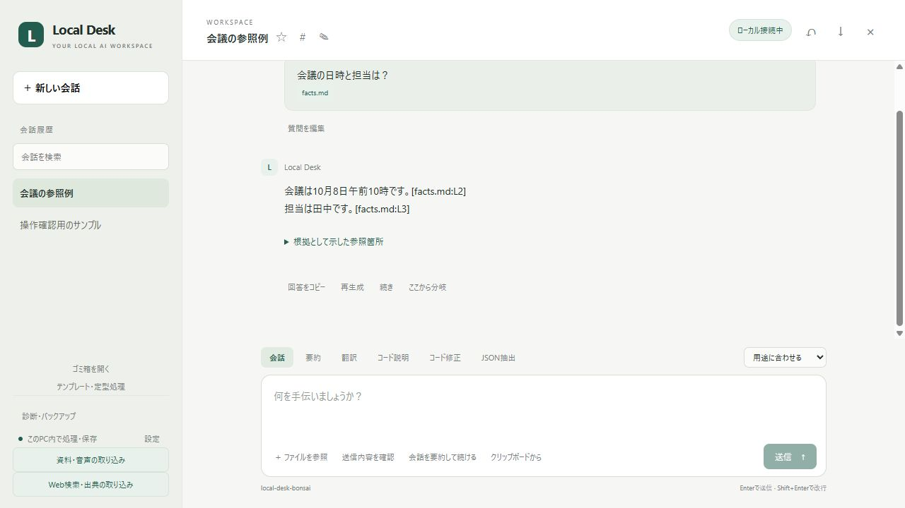
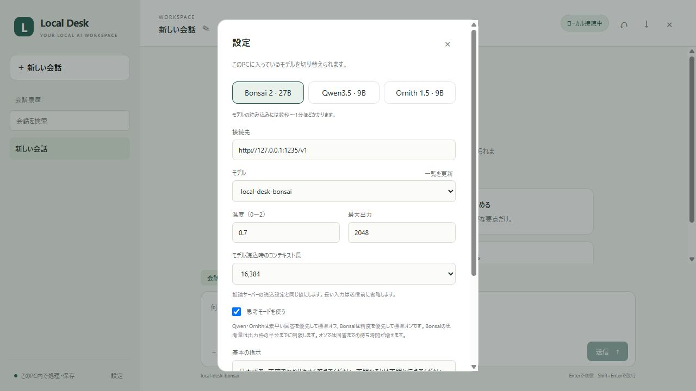
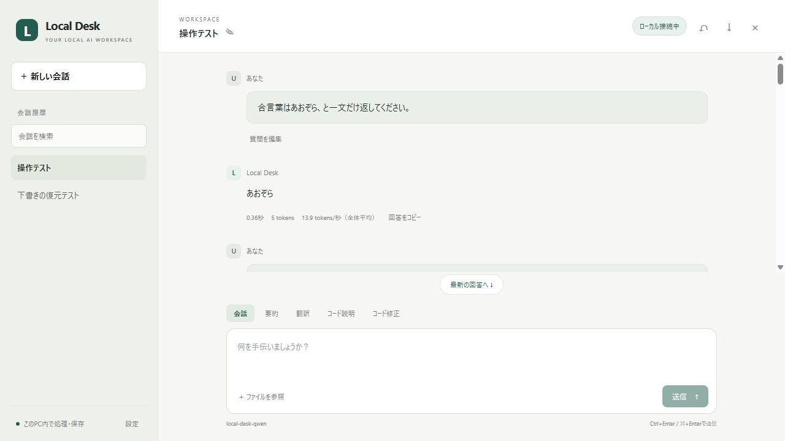

# Local Desk

**自分のPCで動く、日本語のAI作業アシスタント。** 会話、要約、翻訳、コードの説明と修正を、LM StudioまたはBonsai専用エンジンのローカルモデルで行います。

ブラウザ版はPythonの標準ライブラリだけで動作します。専用ウィンドウ版にはpywebviewを使います。アプリの利用にクラウドAPIキー、月額契約、npmのインストールは必要ありません。モデルとウィンドウの環境を準備した後は、インターネット接続なしでも推論できます。電気代とPCの処理能力は必要です。



[ダウンロード](https://github.com/konniciha0912-star/local-desk/releases/latest) · [CI](https://github.com/konniciha0912-star/local-desk/actions) · [MITライセンス](LICENSE)

## できること

### 2.0で追加した機能

- AIに送信するファイルの行範囲、過去の会話数、省略された内容を送信前に確認。
- 会話のピン・タグ・ゴミ箱と復元、元の回答を残す再生成・分岐、続き、会話を要約して続ける機能。
- 許可したプロジェクトの関連箇所検索、行番号付きの根拠、コードの概要。
- 行ごとの修正案を選択し、複数の変更をまとめて反映・取り消し。新規ファイルとPython・JSONの構文チェック。
- GGUFのモデル登録、保存場所の変更、モデル別の設定、用途別の回答量・思考の設定。
- PDF・Word・画像から文字を読み取り、日本語の音声をローカルで文字起こし。確認してから入力欄へ追加。
- 作成・保存できる依頼テンプレート、日報・ログ整理・JSON項目抽出、明示操作でのクリップボード読み取り。
- 必要なときだけWeb検索・ページ取得。検索語・URLだけを外部へ送信し、取得時刻と出典を表示。
- [VS Code拡張](vscode/README.md)でコード説明、確認した差分の反映・取り消し、実験的な補完。
- テーマ・文字サイズ・ウィンドウ位置の復元、GPU・速度・容量の診断、会話・設定・変更履歴のバックアップと復元。

初回はWindowsで **Install.cmd** を開きます。対応するPythonがない場合は、検証した公式Pythonをこのアプリのフォルダーに準備します。導入後はデスクトップの **Local Desk** を開くだけでAIも起動し、ウィンドウを閉じると終了します。

配布ZIPを展開してから起動してください。Windows 64bit、WebView2 Runtime、NVIDIAのCUDA対応ドライバーを使う構成です。Bonsaiのモデルだけで約7.2GBの保存領域が必要です。検証した構成はRTX 5060 Ti 16GB・RAM 32GBで、他のGPUやCPUのみでの専用版動作は未検証です。ブラウザ版は別途用意したローカル推論サーバーにも接続できます。

再インストール時も履歴は保持します。アンインストールの標準操作は `Uninstall-Desktop.ps1` で、履歴とモデルは残します。`-RemoveRuntime` はモデル・実行環境、`-RemoveHistory` は会話・設定・取り消し用コピーを削除する明示的なオプションです。

OCRや生成したコードには間違いがあり得ます。読み取り結果や差分を確認してから使用してください。音声はボタンを押したときだけ、最大30秒録音します。外部機能を使わなければ、導入後の推論・文字抽出・音声認識はこのPC内で完結します。

固定版・利用条件は [Third-party notices](THIRD_PARTY_NOTICES.md)、更新内容は [更新履歴](CHANGELOG.md)、検証の条件と結果は [検証記録](docs/VALIDATION.md) に記録しています。

- 日本語で会話し、回答を少しずつ表示
- 要約・翻訳・コード説明をワンクリックで切り替え
- 選択した最大6個のファイルを質問に添付
- コードの変更前後を確認して反映。バックアップと取り消しに対応
- 会話履歴をSQLiteに保存し、Markdownで書き出し
- 会話のタイトル・本文から検索し、会話の名前を変更
- 下書き・参照ファイル・最近使ったフォルダーを復元
- モデル、最大出力、温度、基本の指示、思考モードを設定
- モバイル幅に対応したブラウザ画面

## 導入したPCで使う

初回インストールは **Bonsai 2 27B** を準備します。開発PCでは **Qwen3.5 9B、Ornith 1.5 9B** も実機検証しました。追加のGGUFは設定の「モデルの登録・保存場所・利用条件」から登録できます。

1. **デスクトップの「Local Desk」アイコンをダブルクリック**。
2. 専用ウィンドウが開き、最後に選んだAIモデルを自動で読み込みます。
3. 質問を入力し、Enterで送信します。Shift+Enterは改行です。

**終了はウィンドウ右上の×だけです。** 生成中や読み込み途中でも、専用のAIプロセスとアプリのサーバーを終了し、GPUメモリを解放します。黒いターミナルやLM Studioを別途開く必要はありません。会話・設定・バックアップは保持します。アイコンをもう一度開くと起動済みのウィンドウを表示し、二重起動しません。

このPCにはショートカットを設置済みです。別の場所へソースを移動した場合は、`Install-Desktop.ps1`を再実行してショートカットを更新してください。専用ウィンドウの初回準備は次のとおりです。

```powershell
.\Install-Desktop.ps1
```

`.runtime/desktop/`に専用のPython環境とpywebview 6.2.1を用意します。WindowsのWebView2 Runtimeも必要です。このPCではインストール済みのランタイムで確認しました。`Desktop.cmd`からも専用ウィンドウを開けます。詳細な構成・終了検証は[デスクトップ版の記録](docs/DESKTOP.md)にあります。

ブラウザ版の下書きと専用ウィンドウの下書きは別の保存領域です。会話履歴・AI設定・ファイルのバックアップは同じ`.data/`を利用します。

ブラウザ版を使う場合は`Start.cmd`、Bonsaiのブラウザ版を直接起動する場合は`Start-Bonsai.cmd`を使えます。こちらは従来どおりターミナルのCtrl+Cで終了します。専用ウィンドウ版と同時には起動しません。起動中も設定画面のモデルボタンで切り替えられます。会話と下書きは保持します。

## モデル切り替え（1.2）

- **Bonsai 2 27B**：思考モードを標準オンにして、修正や慎重に考える質問に使います。16,384のコンテキスト、最大出力2,048。思考には出力枠の半分まで、上限1,024tokensを割り当てます。
- **Qwen3.5 9B**：思考を標準オフにして、短い質問や軽い作業に使います。コンテキスト8,192、最大出力1,536。
- **Ornith 1.5 9B**：日本語の別候補として残しています。思考は標準オフです。

切り替え時にLocal Deskが管理する待機中のモデルをGPUから解放します。生成中の切り替えはできません。別のモデルへ変えると、そのモデルの温度・最大出力・思考の初期値を適用します。同じモデルで再起動する場合は調整済みの設定を保持します。専用ウィンドウ版では3モデルとも付属の専用エンジンを使い、終了時にまとめて停止します。

このPCでBonsaiによる修正案の生成・反映・取り消しを確認しました。小規模な比較結果と条件は[Bonsaiの導入・検証記録](docs/BONSAI.md)にあります。



設定の「Enterキーで送信する」をオフにすると、Enterで改行、Ctrl+Enter（Macは⌘+Enter）で送信できます。Ctrl+Enter / ⌘+Enterはどちらの設定でも使えます。日本語の変換確定では送信しません。

## 使いやすさの改善（1.1）

- **下書きを自動保存**：会話ごとの入力途中の質問を、最大30会話分、このブラウザに保存します。再読み込みや会話の切り替え後に復元します。
- **参照の準備を記憶**：最後に開いたフォルダーと選択したファイルを復元。最近使った5フォルダーから選べます。復元時はファイル名を一覧化し、内容をモデルに送るのは質問を送信した時です。「参照の選択とフォルダーの記憶を解除」で記憶を消せます。
- **履歴を探して整理**：左の検索欄はタイトルと質問・回答の本文が対象。会話名の横の鉛筆で名前を変更できます。未使用で下書きのない空の会話は再利用します。
- **質問を再編集**：過去の質問の「質問を編集」で入力欄に戻せます。元の質問を書き換える操作ではなく、新しい質問として送信します。参照ファイルは現在の選択を確認してください。
- **読み位置を維持**：生成中も上の文章を読めます。「最新の回答へ」で末尾に戻ると、新しい回答を追いかけます。会話の本文はキーボードでもスクロールできます。
- **未接続時の案内**：起動方法、接続設定、再確認を画面に表示します。空の入力や未接続時は送信ボタンを無効にします。

下書き・フォルダーの記憶・送信キー・最後の処理モードはブラウザのローカルストレージに保存します。同じブラウザ・接続URLで利用してください。ブラウザのサイトデータを削除すると消えます。SQLiteの会話履歴とは別の保存先です。



起動したターミナルは開いたままにします。終了はCtrl+Cです。アプリが起動したBonsaiサーバーは一緒に終了します。LM Studioのモデルは、アプリ終了後もGPUに残ります。解放する場合はLM Studioでアンロードするか、`lms unload local-desk-qwen`などを実行してください。

PowerShellから特定のモデルを選ぶこともできます。起動済みなら、そのアプリのモデルを切り替えます。

```powershell
.\Start.ps1 -Model Ornith
.\Start.ps1 -Model Bonsai
```

## 他のPCで準備する

必要なもの：Python 3.10以上、[LM Studio](https://lmstudio.ai/)、ダウンロード済みのGGUF会話モデル。今回確認した環境はWindows / Ryzen 7 7800X3D / メモリ32GB / RTX 5060 Ti 16GBです。小さいモデルでも動作しますが、性能と速度は変わります。

1. LM Studioをインストールし、一度起動します。
2. LM Studioで`Qwen3.5-9B`を検索し、`lmstudio-community`の`Q4_K_M`をダウンロードします。テキストのみのこのアプリでは画像用の`mmproj`は使いません。
3. LM StudioのCLIが使えることを確認します。Windowsの通常の配置は`%USERPROFILE%\.lmstudio\bin\lms.exe`です。
4. `Start.cmd`を実行します。モデルの読み込みとローカルサーバーの開始を行います。

モデルの配布元：

- [Qwen3.5 9B GGUF](https://huggingface.co/lmstudio-community/Qwen3.5-9B-GGUF)：今回のファイルサイズ約5.63GB
- [Ornith 1.5 9B GGUF](https://huggingface.co/ornith-ai/Ornith-1.5-9B-GGUF)：Q6_Kは約7.56GB

Pythonが見つからない場合は、起動スクリプトの`-PythonPath`に実行ファイルを指定できます。このPCではCodexに付属するPythonも自動検出します。他のPCにそのランタイムがあるとは限らないため、通常はPythonを用意してください。

### Bonsaiを準備する（Windows / NVIDIA）

公式のWindows CUDA 13.3版専用エンジンとPQ2_0モデルを使います。対応するNVIDIAドライバーと十分な空き容量が必要です。CUDA Toolkitの別途インストールは不要でした。このPCのRTX 5060 Ti 16GB / ドライバー616.92で検証済みです。

```console
python setup_bonsai.py
Start-Bonsai.cmd
```

初回はモデル7.21GBとエンジン・DLL約0.54GBをダウンロードし、SHA-256を配布元と照合します。展開後も含めて約9GBの空き容量を用意してください。中断後は再実行で再開します。保存先は`.runtime/bonsai/`です。通常のllama.cppやLM StudioでこのBonsaiの量子化ファイルを直接動かす構成ではありません。配布元・固定したエンジンの版は[導入記録](docs/BONSAI.md)を参照してください。

### 手動起動・macOS・Linux

LM StudioのGUIでローカルサーバーを開始するか、CLIで次を実行します。

```console
lms server start --port 1234 --bind 127.0.0.1
lms load qwen3.5-9b --gpu max --context-length 8192 --parallel 1 --identifier local-desk-qwen -y
python app.py --open
```

Windowsの`Start.ps1`はWindows用です。Pythonアプリは標準ライブラリで実装していますが、macOS・Linuxの実機検証は未実施です。CPU環境では`--gpu off`を使い、ハードウェアに合うモデルを選んでください。

## コードの説明・修正

1. 「ファイルを参照」で、プロジェクトのフォルダーの絶対パスを入力。
2. 「ファイルを読み込む」を押し、必要なファイルにチェック。
3. 「コード説明」または「コード修正」を選んで質問。
4. 修正案の変更前後を確認し、「この変更を反映」を押します。
5. 元に戻す場合は、その場の「取り消す」、または右上の「↶ 変更履歴」を使います。

`examples/calculator.py`でコード説明を試せます。指定したフォルダーを読み込む操作では、ファイル名を一覧化します。ファイル内容をモデルへ送るのは、チェックしたファイルだけです。

修正案の生成後に元ファイルが変わっていた場合、反映を拒否します。反映後に自分で編集したファイルも、取り消しで上書きしません。UTF-8、UTF-8 BOM、日本語Windows文字コードに対応し、改行を保持します。新規ファイルは「作成先」を追加して承認したパスだけに作れます。モデルの提案だけで削除やコマンド実行は行いません。プロジェクトのテストは、表示した既定のコマンドを確認したときにだけ実行します。

ファイルは1個150KB以下、合計200KB以下。長い入力は、コンテキストに収まるよう末尾を省略し、送信プレビューに表示します。修正案は置換対象が一意に一致したものだけ反映可能です。「行差分を確認」で必要な変更箇所を選び、複数ファイル・同じファイルの複数修正をまとめて検証・反映できます。反映後の取り消しも同じ組の全ファイルに適用します。

## 保存とローカル接続

会話、設定、ファイル変更のバックアップはこのフォルダーの`.data/`に保存します。バックアップは`.data/backups/`です。会話を削除しても、取り消しに必要なバックアップは保持します。履歴やバックアップに機密情報を含めた場合、このフォルダーも機密情報として扱ってください。

アプリは`127.0.0.1`だけで待ち受け、推論先もループバックに限定します。外部Webサイトからの操作を防ぐため、Host・Origin・セッショントークンを確認します。モデルの文章をHTMLとして実行しません。外部フォントやアクセス解析は使いません。LM Studio自体の更新確認やモデル取得の通信は、LM Studio側の設定に依存します。

APIには同じPCからのアクセスを想定しています。他の利用者から隔離するログイン機構や、LAN公開用の構成はありません。

## よくある問題

**サーバー未接続**：設定のモデルボタン、または`Start.cmd`から準備してください。Qwen・Ornithの接続先は`http://127.0.0.1:1234/v1`、Bonsaiは`http://127.0.0.1:1235/v1`です。Bonsaiの起動ログは`.data/bonsai-server.log`に保存します。

**モデルが見つからない**：モデルをダウンロードし、読み込んでください。手動で別の名前で読み込んだ場合はアプリの設定から選択します。一覧には、サーバーが返した利用可能なモデルが表示されます。

**回答が出ない／考える時間が長い**：思考モードをオフにします。最大出力に達した場合は画面に表示します。思考モードをオンにすると、回答前に出力枠を使い切る場合があります。

**長いコードが省略される**：選択するファイルを減らすか、必要な部分を質問に貼り付けます。設定のコンテキスト長は推論サーバーの読込設定と一致させます。この数値の変更だけでは、モデルを再読み込みしません。

**既存のLM Studioに認証を設定している**：任意の推論先への認証トークン設定には未対応です。Bonsai専用サーバーの認証キーはアプリが`.data/`に生成し、ブラウザに渡さず利用します。

**ポート8765が使用中**：起動済みの画面を開くか、`python app.py --port 8766 --open`を実行してください。

## 開発とGitHubへの公開

ブラウザ版と以下のテストには追加のPythonパッケージは必要ありません。専用ウィンドウ版の依存関係は`requirements-desktop.txt`に分離しています。

```console
python -m unittest discover -s tests -v
```

Pythonテストには実モデルもネット接続も不要です。ファイル変更・文字コード・履歴・接続制限・HTTPストリーミング・停止を検証します。画面コードのテストはNode.js 24で `npm ci --prefix tests/ui` と `npm test --prefix tests/ui`、拡張クライアントは `node --test vscode/client.test.js` です。GitHub ActionsはWindows/UbuntuのPython 3.10/3.12/3.13/3.14と、Windowsの固定した専用ウィンドウ依存を検査します。実機での結果と限界は[検証レポート](docs/VALIDATION.md)を参照してください。

構成：`app.py`がPythonサーバー、`engines.py`がモデルの起動・切り替え、`desktop.py`が専用ウィンドウと終了管理、`setup_bonsai.py`がBonsaiの導入、`web/`が画面、`tests/`がテスト、`Start.ps1`がブラウザ版のWindows起動処理です。専用ウィンドウの構成は[デスクトップ版の記録](docs/DESKTOP.md)にまとめています。

公開リポジトリは [konniciha0912-star/local-desk](https://github.com/konniciha0912-star/local-desk) です。`.gitignore`で`.data/`、`.runtime/`、モデル、仮想環境、キャッシュを除外しています。`python tools/package_source.py` は公開用のソースだけを選び、ファイルのSHA-256一覧を含むZIPを作ります。

アプリのソースはMITライセンスです。LM Studioとモデルには、それぞれの配布元のライセンスが適用されます。モデルファイルはこのソースに同梱していません。

## 現在の範囲と限界

チャットと、選択した参照範囲を使う作業支援を提供します。画像はOCRで文字に変換し、画像そのものを理解する構成ではありません。VS Code補完は実験的で、大きなプロジェクトを自律的に探索・実行するエージェントにはしていません。クラウドの最上位モデルと同等の能力を保証するものではなく、回答・OCR・修正案には間違いがあります。小規模テストでも、要約で会議時刻を誤って解釈する例がありました。
