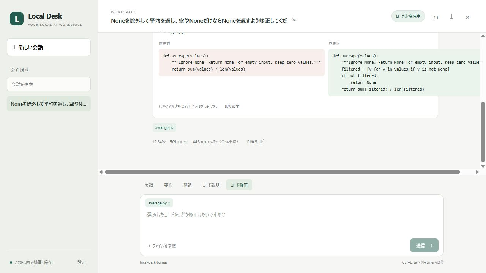

# Bonsai追加計画と実機検証

作成日：2026-10-07。ユーザーの許可に基づいてTernary Bonsai 2 27Bを追加し、標準のQwen3.5 9Bと比較する。

## 作業計画

1. PrismML公式のモデルと専用llama.cppの配布物を確認する。
2. RTX 5060 Ti 16GB向けにPQ2_0版を準備する。モデルのSHA-256を配布元と照合する。
3. エンジンとモデルは公開用ソースと分離して保存する。ローカル接続のみで起動し、コンテキストはまず8,192で検証する。実装時に16,384でもメモリに収まることを確認できたため、最終設定は16,384とした。
4. 日本語の要約、指示追従、Pythonの修正問題を共通の課題で比較する。生成速度、使用メモリ、停止、思考オフ／オンの互換性を実測する。
5. Local DeskでBonsaiと既存モデルを使い分けられる起動処理を作り、通常操作をブラウザで確認する。
6. 検証結果・起動手順・ソースZIPを更新する。比較で問題があれば設定を調整し、最終的に使いやすい設定を選ぶ。

既存の会話・バックアップとモデルファイルを保持する。評価用データは通常の会話履歴から分離する。追加候補の順位は実測結果に応じて見直す。

## 配布元

- [公式モデル](https://huggingface.co/prism-ml/Ternary-Bonsai-2-27B-gguf)
- [公式デモ・推奨設定](https://github.com/PrismML-Eng/Bonsai-demo)
- [専用llama.cpp](https://github.com/PrismML-Eng/llama.cpp)

## 検証結果

### 導入結果

2026-10-07に導入完了。Windows / Ryzen 7 7800X3D / RAM 32GB / RTX 5060 Ti 16GB、ドライバー616.92でGPU推論を確認した。

- モデル：Ternary-Bonsai-2-27B-PQ2_0.gguf、7,206,168,928 bytes
- エンジン：公式デモに合わせて`prism-b10743-adfffbe`を固定。`0.2.0-dev`、build 10743、commit `adfffbe41`、Windows CUDA 13.3 x64
- コンテキスト16,384、並列枠1、GPUオフロード99、Flash Attentionオン
- GPU全体の使用量：9,449 MiB（約9.23 GiB）。画面描画なども含むスナップショットで、モデル単体の値ではない。比較時のQwenは6,605 MiB
- localhost:1235だけで待ち受け。専用認証キーをアプリ側で保持し、サーバーのWeb UIは無効

モデル・エンジン・CUDA DLLのすべてを配布元のSHA-256と照合した。モデルのSHA-256：

```text
3907dc1658db1f78a9826bf8d5bcb8dc65db0d466388937af57f2294fae62ec1
```

完全な取得記録は`.runtime/bonsai/manifest.json`にある。モデル、実行ファイル、履歴、認証キーは公開用ZIPに含めない。

### 小規模な比較

日本語の時刻変更の要約、不明な情報をnullにするJSON、否定を含む翻訳と、Pythonの順序保持・Noneを除外する平均・上下限の処理の計6課題。思考オフで各2回実行した。PythonはJSONが安全に反映可能かを確認し、変更後の純粋関数を境界ケースで実行した。日本語は指定語・禁止表現・JSON形式による簡易判定と、要約の目視確認を行った。

共通設定は温度0.2、最大出力1,536、ストリーミング。QwenはLM Studio / Q4_K_M / コンテキスト8,192、Bonsaiは専用エンジン / PQ2_0 / 16,384。Bonsaiには公式のtop_p・top_k・min_p・presence_penaltyも適用している。量子化、エンジン、サンプリングの細部が異なるため、厳密なモデル単体の同条件比較ではない。

- **Qwen・思考オフ**：Python 3/6成功。簡易判定は合計9/12。全課題の所要時間の中央値2.165秒、範囲0.309〜3.819秒。
- **Bonsai・思考オフ**：Python 6/6成功。簡易判定は合計11/12。中央値2.019秒、範囲0.505〜5.632秒。
- **Bonsai・思考オン**：同じ6課題を追加で1回ずつ実行し、6/6成功。中央値8.803秒、範囲2.359〜15.473秒。思考予算1,024tokens、reasoning_effortはmedium。

Qwenでは平均の0を除外する誤りと、反映できないclampのJSONがあった。Bonsaiの思考オフでは、会議の「開始を10時から11時に変更」を「10時開始・11時まで」と誤読した。また2回目の「10時〜11時に変更」という表現も曖昧で、簡易判定の成功数は要約の品質を十分に表していない。思考オンの回答では「開始10時→11時」「終了時刻は記載なし」を正しく明記した。

この結果に合わせて、Bonsaiは思考オン、Qwenは素早い回答用に思考オフを初期値にした。アプリのBonsai初期値は温度0.7・出力2,048で、思考予算は1,024になる。比較値は短い課題の通信・入力処理を含む時間であり、長い会話や実プロジェクト全体での性能を示さない。少数の試行で、クラウドモデルと同等という評価ではない。

### アプリの実操作と自動テスト

通常の会話履歴とは別の検証用データで、ブラウザからモデル切り替えと下書きの保持を確認。Bonsaiの思考オンでaverage.pyの修正案を12.84秒で生成し、画面から反映した。`[None, 0, 6]`、空、Noneのみ、`[2, 4]`の4ケースが成功した。取り消し後は元のバイト列に完全一致した。生成途中の停止も画面で確認した。

Python 3.12.14 / 3.14.4の両方で22テスト中21件成功、1件スキップ。Windowsのシンボリックリンク作成権限によるスキップ。モデル切り替えの永続化、失敗時の復旧、思考予算、認証キーをブラウザに渡さないこと、生成中の設定・切り替え拒否、実行ファイルの参照除外を追加で確認した。


