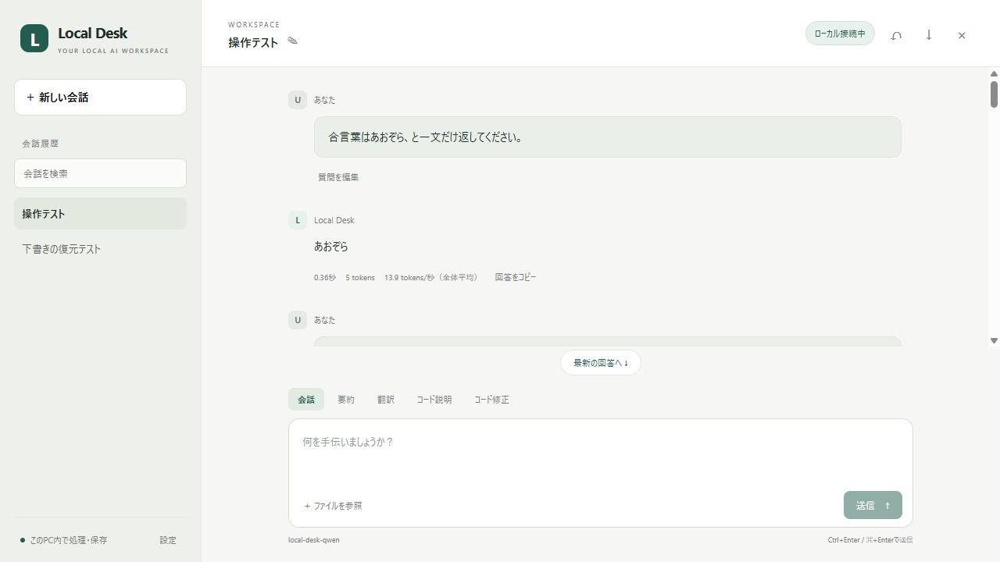
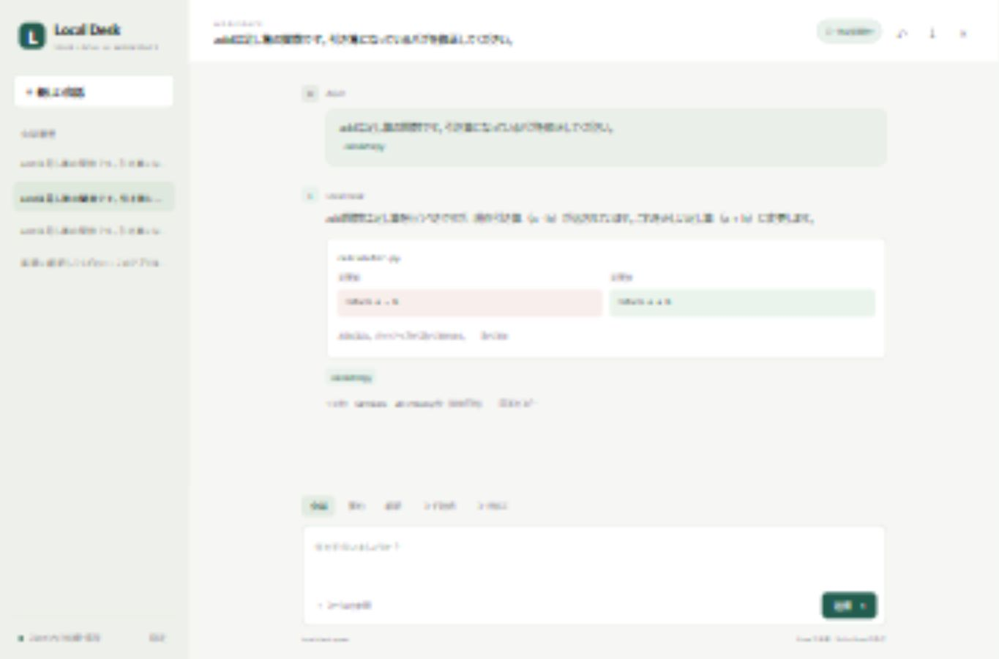

# 実機検証レポート

## 2.0の追加検証（2026年10月7日）

- Windowsの最終Python 3.12検証は76テスト中75成功、1スキップ。Python 3.13.16 / 3.14でもそれ以前の75テスト中74成功、1スキップ。スキップはWindowsのシンボリックリンク作成権限です。追加した検査は公開ZIPを別フォルダーへ展開してアプリを独立してimportできることです。
- 新規環境で公式の専用Python 3.13.16と45個の固定依存を導入し、依存の整合性確認に成功。通常のアンインストールは履歴を保持し、外部へのjunctionがある削除先を拒否します。
- 専用PrismエンジンでBonsai / Qwen / Ornithに要約・翻訳・コード説明・修正を各2回依頼し、24回すべての簡単な検査に成功。修正は保存したファイルに反映し、構文・挙動を検査して取り消しました。一般的な知能の評価ではありません。
- RTX 5060 Ti 16GB、Ryzen 7 7800X3D、RAM 32GB。短い `add` 関数の補完9試行が成功。Qwenは0.109〜0.203秒、Ornithは0.125〜0.250秒。反復にはプロンプトキャッシュが含まれ、実際の長いコードで同じ速度になるとは限りません。
- 本物のVS Code拡張ホストで補完と日本語説明に成功し、配布VSIXをVS Codeに導入しました。拡張のUIサービスをテスト用に置き換えた追加検証では、実Bonsai・実APIで修正案を作り、読み取り専用の差分を開いてから実ファイルへ反映し、元の内容へ取り消すところまで成功しました。
- JSDOMで実際の画面コードを読み込む7テストに成功。短いストリームの段階表示、テーマと文字サイズの再読込、ショートカット、再生成・続き・分岐、ピン・タグ・削除確認・復元、検索の行選択、検証済み/未検証出典、差分の一部反映・一括取り消しを確認しました。最後のブラウザー操作は操作ツールのクリックが反映されないため、この部分はDOMコードテストです。
- 実際の `desktop.main` とWebView2で980×660・座標120,90を保存し、別プロセスで開き直して同じ値へ復元しました。終了試験は起動0.2秒後・生成中・モデル切替中・上流のヘッダー待ち・異常終了を含み、所有したAIの停止と再起動を確認しました。
- PDF本文・Word本文と表・画像OCR・画像PDFから文字抽出に成功。日本語OCRには「ローカル」を「口一力ル」と読む誤りがあり、結果を確認・編集してから送信します。
- ローカルWhisperで日本語・英語の合成WAVを実際に文字起こししました。ユーザーのマイクの実録音は行っていません。
- 送信プレビューで過去の会話0件・ファイル2〜3行の指定が反映されることを画面で確認。Bonsaiの実測入力トークン数と生成側の使用量が一致しました。
- 通常のユーザー用デスクトップアプリを起動し直し、Bonsai・16,384コンテキスト・接続可能を確認。通常の履歴とモデルを保持しています。

公開ZIPから私的データと実行環境を除外する検査、同梱した表示ライブラリのSHA-256確認もテストに含めています。以下は以前の版の記録です。

実モデル24試行の条件・回答・速度は [公開用の検証データ](benchmark-2.json) に保存しています。公開CIの結果は [GitHub Actions](https://github.com/konniciha0912-star/local-desk/actions) で確認できます。過去の版にある「CI未実行」「対象外」はその時点の記録です。

## 専用ウィンドウと起動・終了の一体化（2026年10月7日）

デスクトップのショートカットからAIと画面を一括起動し、専用ウィンドウの終了で両方停止する構成を追加しました。実機で通常終了・読み込み途中の終了と接続ポートの解放を確認しています。Python 3.12.14 / 3.14.4の両方で26テスト中25件成功、1件スキップ。詳細は[デスクトップ版の記録](DESKTOP.md)を参照してください。

## 1.2のBonsai導入・モデル切り替え（2026年10月7日）

Ternary Bonsai 2 27B PQ2_0と公式の専用Windows CUDAエンジンを導入。コンテキスト16,384でRTX 5060 Ti 16GB上の推論を確認しました。画面の設定からモデルを切り替え、下書きを保持し、Bonsaiによる修正案を反映・取り消すまで確認済みです。詳細な比較条件、少数試行の結果と限界は[Bonsai検証記録](BONSAI.md)を参照してください。

Python 3.12.14 / 3.14.4の両方で22件中21件成功、1件スキップ。Windowsのシンボリックリンク作成権限によるものです。過去の検証結果は以下に版ごとの記録として残します。

## 1.1の使いやすさ改善（2026年10月7日）

Python 3.12.14と3.14.4の両方で17件中16件成功、1件スキップ。スキップは引き続きWindowsのシンボリックリンク作成権限によるものです。追加した検証は、タイトル・本文検索、検索記号 `%` / `_` の文字としての扱い、名前変更の永続化・入力検証、HTTP経由の検索・名前変更、生成中の名前変更の拒否です。

既存の会話・設定・バックアップと分離した検証用データで、ブラウザから以下を確認しました。

- 再読み込み後の下書き、処理モード、フォルダー、`calculator.py`の選択復元
- 会話を切り替えても下書きを保持。新しい会話を2回開いても空の会話が増えない
- タイトル検索、該当なし表示、会話名の変更。タイトルを変えた後も「あおぞら」で本文を検索できる
- Enter送信をオフにしてEnterで改行。Ctrl+Enterで実モデルに送信し、回答を取得。「質問を編集」で入力に戻る
- 実モデルによる長文生成中、先頭へ戻ってから回答が増えても`scrollTop == 0`を維持。「最新の回答へ」で末尾に戻る
- 未接続時の起動案内と送信ボタンの無効化
- 390×844でメニュー・検索・会話切り替え・下書きの復元。ページ幅390pxで横方向のはみ出しなし
- 通常幅で検索欄・名前変更・質問再編集・最新回答ボタンを表示。ブラウザのエラー・警告ログなし

JavaScriptの構文確認も成功しました。通常の`Start.cmd`起動で標準モデルを読み込み、ポート8765でアプリ1.1を起動しています。GitHubのCIは公開前のため未実行です。



---

検証日：2026年10月5日。初版の機能と、このPCでの実測結果を記録します。

## 環境

- Windows、AMD Ryzen 7 7800X3D、メモリ約32GB
- NVIDIA GeForce RTX 5060 Ti、VRAM 16,311 MiB
- LM StudioのローカルAPI、GPUオフロード最大、コンテキスト8,192
- オフラインテスト：Python 3.12.14と3.14.4
- 起動スクリプトからの実行：Python 3.14.4
- 標準モデル：Qwen3.5 9B Q4_K_M、`local-desk-qwen`
- 比較用：Ornith 1.5 9B Q6_K、`local-desk-ornith`

モデルはダウンロード後、Hugging Faceの配布メタデータに記載されたSHA-256と照合して一致しました。

```text
Qwen3.5-9B-Q4_K_M.gguf
cd76ec205963b3b33350093e6904d9de16c4e666fd104e1f632d25c7f15f2a13

Ornith-1.5-9B-Q6_K.gguf
b6f76e74f86245b3caee014b797c10dca931c4dfdaabfb134eab655f81e4154a
```

## 自動テスト

Python 3.12.14と3.14.4の両方で、14件中13件成功、1件スキップ。スキップはWindowsでシンボリックリンク作成の権限がないためです。シンボリックリンクの実作成を伴う検証は、このPCでは完了していません。

確認した内容：

- ローカル以外の接続先、URL認証情報、不正なポートの拒否
- パスの逸脱、`.env`、大きすぎるファイルの除外
- 会話の保存・取得・削除と設定の永続化
- 実行可能な修正案の検証、バックアップ、取り消し
- 修正済み状態の再取得、取り消し状態の復元
- CRLF、UTF-8 BOM、CP932の保持
- 生成後／反映後に変更されたファイルへの上書き拒否
- 選択外ファイルや曖昧な置換対象を含むモデル出力の拒否
- Host、Origin、セッショントークンの検証と静的ファイルのアクセス制限
- 模擬推論サーバーを用いたHTTPストリーミング、思考・使用トークンの保存
- 推論サーバーの失敗後の復旧、生成停止、同時生成・生成中の削除の拒否

JavaScriptはNode.jsの`--check`で構文確認済みです。GitHub Actionsの設定は作成済みですが、GitHubには公開していないためCIは未実行です。Python 3.10とLinux/macOSの実機検証は未実施です。

## 実モデルの速度

短い固定プロンプトを各1回実行した結果です。温度0.2、最大出力1,024、思考オフ。標準モデルの初回比較時は並列枠4、Ornithは1でした。単一リクエストで測定しました。最終の標準設定は並列枠1です。反復した統計的ベンチマークではありません。

- **Qwen3.5 9B**：短文要約1.523秒、最初の回答0.457秒、出力69tokens。簡単なコード修正JSONは0.886秒、最初の回答0.176秒、出力46tokens。
- **Ornith 1.5 9B**：同じ短文要約1.363秒、最初の回答0.353秒、出力79tokens。コード修正JSONは0.897秒、最初の回答0.203秒、出力55tokens。
- **完成アプリ経由のQwen**：コード修正案の生成1.18秒、入力209tokens、出力58tokens。翻訳は画面操作で0.91秒、出力16tokens。

これらは短く単純な課題です。大きいコード、長い会話、複雑な推論に同じ速度や精度を保証しません。測定値には入力処理や通信時間も含みます。Qwenを読み込んだ後のGPU全体の使用量は6,652 MiBでした。画面表示など他のプロセスも含む値です。

## 修正・取り消しの実機確認

専用のテストファイルで`add(a, b)`が`a - b`を返すバグを用意しました。モデルが作ったJSONをアプリが検証し、バックアップを作って反映。実際に関数を実行し、`add(3, 5) == 8`を確認しました。その後取り消し、元のバイト列とCRLFが完全に一致しました。

ブラウザからもファイル選択、修正案の生成、反映、再読み込み後の反映済み表示、取り消しを確認しました。変更履歴からの取り消し、翻訳、モデルの接続表示、設定画面、新しい会話、会話の再表示、生成停止も操作しました。実モデルの停止は約0.3秒で完了し、モデルが待機状態に戻ることをCLIで確認しました。

画面幅1,365×900と390×844で表示を確認しました。モバイル幅のページ全体の幅は390pxで、横方向のはみ出しはありません。モバイルのメニューから新しい会話を開くことも確認しています。



## 見つかった問題と限界

初期設定では、Qwenが思考だけで1,024tokensを使い切り、19.208秒待っても要約の回答本文が空になる例がありました。LM Studioのこの実行環境で`reasoning_effort: "none"`が効くことを確認し、アプリの標準設定を思考オフにしました。思考オンは設定に残してあり、最大出力に達した場合は画面に通知します。

要約の正確さにも限界があります。入力の「会議は10時から11時に変更」を、Ornithは「10時開始・11時終了」と解釈しました。Qwenは時刻変更の表現を保ちましたが、会場も変更されたような記述を加えました。短い課題でもモデルは事実を取り違えます。速度の測定だけで、高度な理解や正確さを示したものではありません。

この初版は、選択した既存ファイルへの置換案を扱います。複数ファイルを自律的に探索・実行するエージェント、VS Codeの入力補完、画像、音声、ネット検索は対象外です。標準のコンテキストは8,192で、長い参照内容は末尾を省略します。Pythonアプリはローカル専用で、LANへの公開や複数利用者向けの認証には対応していません。
